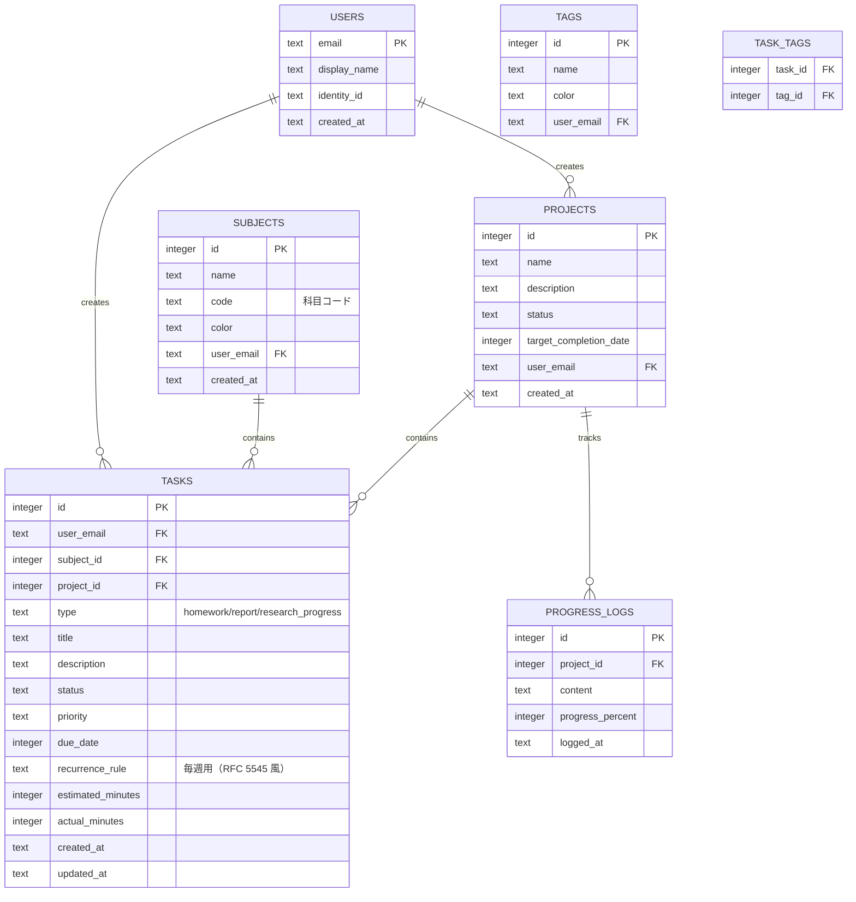

# 02. データベース設計（Cloudflare D1）

D1 は SQLite 互換のサーバレス RDBMS。Drizzle ORM を使用して型安全に管理する。

## 1. ER 図



## 2. テーブル定義

### users

単一所有者を前提だが、将来の共有化に備えて分離。

| カラム | 型 | 制約 | 説明 |
|---|---|---|---|
| `email` | TEXT | PK | Cloudflare Access から取得したメール |
| `display_name` | TEXT | | 表示名 |
| `identity_id` | TEXT | 一意 | Access Identity（オプション） |
| `created_at` | TEXT | | ISO8601 |

### subjects

「科目」を表す。毎週の宿題やレポートを整理する単位。

| カラム | 型 | 制約 | 説明 |
|---|---|---|---|
| `id` | INTEGER | PK, AUTOINCREMENT | |
| `name` | TEXT | NOT NULL | 例：「制御工学」 |
| `code` | TEXT | | 科目コード |
| `color` | TEXT | | UI 表示色（# hex） |
| `user_email` | TEXT | FK → users.email | |
| `created_at` | TEXT | | ISO8601 |

### projects

研究プロジェクト等、長期的な活動単位。

| カラム | 型 | 制約 | 説明 |
|---|---|---|---|
| `id` | INTEGER | PK, AUTOINCREMENT | |
| `name` | TEXT | NOT NULL | 例：「〇〇ロボットの設計」 |
| `description` | TEXT | | 詳細 |
| `status` | TEXT | NOT NULL | `active`, `paused`, `completed` |
| `target_completion_date` | INTEGER | | UNIX タイムスタンプ |
| `user_email` | TEXT | FK → users.email | |
| `created_at` | TEXT | | ISO8601 |

### tasks

宿題、レポート、研究プロジェクトの進捗タスクを統合。

| カラム | 型 | 制約 | 説明 |
|---|---|---|---|
| `id` | INTEGER | PK, AUTOINCREMENT | |
| `user_email` | TEXT | FK → users.email | |
| `subject_id` | INTEGER | FK → subjects.id, NULLABLE | 科目紐付け |
| `project_id` | INTEGER | FK → projects.id, NULLABLE | プロジェクト紐付け |
| `type` | TEXT | NOT NULL | `homework`, `report`, `research_progress` |
| `title` | TEXT | NOT NULL | タスク名 |
| `description` | TEXT | | 詳細 |
| `status` | TEXT | NOT NULL | `not_started`, `in_progress`, `completed`, `archived` |
| `priority` | TEXT | NOT NULL | `low`, `medium`, `high`, `urgent` |
| `due_date` | INTEGER | | 締切（UNIX タイムスタンプ） |
| `recurrence_rule` | TEXT | | 毎週用。簡易形式：`FREQ=WEEKLY;BYDAY=MO` |
| `estimated_minutes` | INTEGER | | 見積時間（分） |
| `actual_minutes` | INTEGER | | 実績時間（分） |
| `created_at` | TEXT | | ISO8601 |
| `updated_at` | TEXT | | ISO8601 |

### progress_logs

研究プロジェクトの進捗メモ。project_id に紐づく。

| カラム | 型 | 制約 | 説明 |
|---|---|---|---|
| `id` | INTEGER | PK, AUTOINCREMENT | |
| `project_id` | INTEGER | FK → projects.id | |
| `content` | TEXT | NOT NULL | 進捗内容 |
| `progress_percent` | INTEGER | | 0〜100 |
| `logged_at` | TEXT | | ISO8601 |

### tags / task_tags

自由なタグ付け用。

#### tags

| カラム | 型 | 制約 | 説明 |
|---|---|---|---|
| `id` | INTEGER | PK, AUTOINCREMENT | |
| `name` | TEXT | NOT NULL | |
| `color` | TEXT | | |
| `user_email` | TEXT | FK → users.email | |

#### task_tags

| カラム | 型 | 制約 | 説明 |
|---|---|---|---|
| `task_id` | INTEGER | FK → tasks.id | |
| `tag_id` | INTEGER | FK → tags.id | |

## 3. インデックス

```sql
CREATE INDEX idx_tasks_user_email ON tasks(user_email);
CREATE INDEX idx_tasks_due_date ON tasks(due_date);
CREATE INDEX idx_tasks_status ON tasks(status);
CREATE INDEX idx_tasks_type ON tasks(type);
CREATE INDEX idx_tasks_subject_id ON tasks(subject_id);
CREATE INDEX idx_tasks_project_id ON tasks(project_id);
CREATE INDEX idx_progress_logs_project_id ON progress_logs(project_id);
```

## 4. データの例

### 毎週の宿題

```sql
INSERT INTO subjects (name, code, color, user_email, created_at)
VALUES ('制御工学', 'MEC-301', '#3B82F6', 'user@example.com', '2026-04-01T00:00:00Z');

INSERT INTO tasks (user_email, subject_id, type, title, status, priority, due_date, recurrence_rule, created_at, updated_at)
VALUES ('user@example.com', 1, 'homework', '制御工学 演習問題', 'not_started', 'medium', 1743984000, 'FREQ=WEEKLY;BYDAY=MO', '2026-04-01T00:00:00Z', '2026-04-01T00:00:00Z');
```

### レポート

```sql
INSERT INTO tasks (user_email, subject_id, type, title, status, priority, due_date, estimated_minutes, created_at, updated_at)
VALUES ('user@example.com', 1, 'report', '制御工学 中間レポート', 'in_progress', 'high', 1746057600, 480, '2026-04-01T00:00:00Z', '2026-04-01T00:00:00Z');
```

### 研究プロジェクト

```sql
INSERT INTO projects (name, description, status, target_completion_date, user_email, created_at)
VALUES ('歩行ロボットの制御系設計', '卒業研究', 'active', 1751328000, 'user@example.com', '2026-04-01T00:00:00Z');

INSERT INTO tasks (user_email, project_id, type, title, status, priority, due_date, created_at, updated_at)
VALUES ('user@example.com', 1, 'research_progress', 'モータ特性の測定', 'not_started', 'high', 1743984000, '2026-04-01T00:00:00Z', '2026-04-01T00:00:00Z');

INSERT INTO progress_logs (project_id, content, progress_percent, logged_at)
VALUES (1, '理論モデルの作成が完了', 30, '2026-04-01T00:00:00Z');
```

## 5. 毎週タスクの扱い

- `recurrence_rule` があるタスクを「マスター」とする。
- 当日・今週の表示時に、マスターから該当する期間のインスタンスを動的に生成（アプリ側 or クエリ側）。
- 完了状態は「その週のインスタンス」に対して持たせる。D1 には完了履歴テーブル `task_completions` を追加して保存する方式がシンプル。

### task_completions（推奨追加）

| カラム | 型 | 制約 | 説明 |
|---|---|---|---|
| `id` | INTEGER | PK, AUTOINCREMENT | |
| `task_id` | INTEGER | FK → tasks.id | マスタータスク |
| `completed_date` | INTEGER | | 完了した日（UNIX タイムスタンプ） |
| `created_at` | TEXT | | ISO8601 |

```sql
CREATE INDEX idx_task_completions_task_id ON task_completions(task_id);
CREATE INDEX idx_task_completions_completed_date ON task_completions(completed_date);
```
